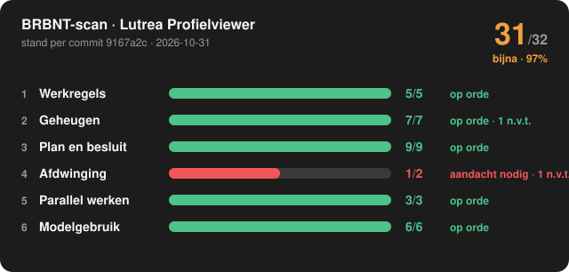

# BRBNT-scan: Lutrea Profielviewer

**31 van 32 meetbare criteria gehaald (97%): 🟠 bijna** (±0)

Stand per commit [`9167a2c`](https://github.com/marcovansteenbrugge/Profielen-app/commit/9167a2cdf2bb8ec50a1a35e409c53067ca71a6e2) op `main`, gescand 2026-10-31 10:56 UTC. Criteria versie 7.
Vergeleken met de scan van 2026-10-30.

> **Het volledige dashboard:** open [dashboard.html](dashboard.html), kies "Download raw file" en open het bestand. Het werkt ook zonder internet.

## Per laag

| Laag | Score | Oordeel | Niet meegeteld | Groeien met |
|---|---|---|---|---|
| 1 Werkregels | 5/5 (±0) | 🟢 op orde | – | `brbnt-project-setup` |
| 2 Geheugen | 7/7 (±0) | 🟢 op orde | 1 n.v.t. | `brbnt-memory` |
| 3 Plan en besluit | 9/9 (±0) | 🟢 op orde | – | `brbnt-plan` |
| 4 Afdwinging | 1/2 (±0) | 🔴 aandacht nodig | 1 n.v.t., 6 niet te meten | `brbnt-skill-scaffold` |
| 5 Parallel werken | 3/3 (±0) | 🟢 op orde | 2 niet te meten | `brbnt-parallel-setup` |
| 6 Modelgebruik | 6/6 (±0) | 🟢 op orde | – | `brbnt-plan` |

Score per laag = gehaald ÷ (gehaald + niet gehaald). Alles gehaald is groen, vanaf 75% amber, daaronder rood.

## Nu van jou gevraagd

Niets: er staat geen besluit of vrijgave open.

## Signalen

- ℹ️ Info: CLAUDE.md noemt 2 pad(en) die niet in de repo staan (kan bewust zijn, bijvoorbeeld een vervallen bestand)

## Criteria

### Laag 1 · Werkregels: 5/5, op orde

| | # | Criterium | Bewijs |
|---|---|---|---|
| ✅ gehaald | 1.1 | CLAUDE.md staat in de root | CLAUDE.md, 120 regels |
| ✅ gehaald | 1.2 | Sectie "Plan en besluit" met de markering op de huidige versie (v1) | Markering brbnt-plan-regel: v1 gevonden |
| ✅ gehaald | 1.3 | Vereisten V1 tot en met V5 zijn aanwezig | V1 tot en met V5 aanwezig |
| ✅ gehaald | 1.4 | Minstens één regel wordt aantoonbaar afgedwongen | 1 van 33 regels noemen een bestaande test, hook of check |
| ✅ gehaald | 1.5 | Elke bewaking die CLAUDE.md noemt, bestaat ook | Alle 3 genoemde bewakingen in de repo bestaan |

### Laag 2 · Geheugen: 7/7, op orde

| | # | Criterium | Bewijs |
|---|---|---|---|
| ✅ gehaald | 2.1 | memory/MEMORY.md staat in de repo | memory/MEMORY.md is gecommit |
| ✅ gehaald | 2.2 | Index en map sluiten op elkaar, in beide richtingen | 1 bestanden, 1 indexregels |
| ✅ gehaald | 2.3 | Elke memory heeft name, description en een geldig type | Alle 1 compleet |
| ✅ gehaald | 2.4 | Geen kapotte [[links]] | Alle links wijzen naar een bestaande memory |
| ➖ n.v.t. | 2.5 | Elke feedback-memory heeft Why én How to apply | Geen feedback-memories |
| ✅ gehaald | 2.6 | Elke project-memory heeft een Why | Alle 1 met Why |
| ✅ gehaald | 2.7 | Elke memory noemt een datum als herkomst (user-memory uitgezonderd) | Alle 1 noemen een datum |
| ✅ gehaald | 2.8 | Het geheugen leeft: iets gewijzigd in de laatste 30 dagen | 1 memories gewijzigd in de laatste 30 dagen |

### Laag 3 · Plan en besluit: 9/9, op orde

| | # | Criterium | Bewijs |
|---|---|---|---|
| ✅ gehaald | 3.1 | Docs-map met plan-beslis-index.md | docs/plan-beslis-index.md |
| ✅ gehaald | 3.2 | Minstens één plan in het standaardformaat (plan + beslisdocument) | 3 plan(nen) |
| ✅ gehaald | 3.3 | De index en de statussen kloppen met wat sync berekent | sync (droogloop): niets aan te passen |
| ✅ gehaald | 3.4 | Elk genomen besluit heeft wie, wanneer en via wat | Alle 11 besluiten volledig vastgelegd |
| ✅ gehaald | 3.5 | Elke vrijgave heeft een naam, een tijdstip en een planversie | Alle 16 vrijgaven volledig |
| ✅ gehaald | 3.6 | Elke gebouwde fase haalt de toets-poort (plan.mjs toets) | 16 van 16 gebouwde fasen getoetst per criterium |
| ✅ gehaald | 3.7 | De planversie in de kop is de hoogste versie uit het wijzigingslog | Kop en wijzigingslog gelijk |
| ✅ gehaald | 3.8 | Commits voor planwerk dragen de fase-prefix uit het plan (F2: of CMS-F2:) | 47 commit(s) met een fase-prefix |
| ✅ gehaald | 3.9 | Niets wacht langer dan 7 dagen op de beslisser | Er wacht niets op de beslisser |

### Laag 4 · Afdwinging: 1/2, aandacht nodig

| | # | Criterium | Bewijs |
|---|---|---|---|
| ❌ niet gehaald | 4.1 | Er is een testsuite en die draait in CI | 25 testbestanden, maar geen CI-workflow |
| ❔ niet te meten | 4.2 | De laatste run na een push op de hoofdtak is geslaagd | Geen afgeronde run na een push op main |
| ❔ niet te meten | 4.3 | Minstens 90% van de laatste 30 runs na een push op de hoofdtak slaagt bij de eerste poging (geannuleerd telt niet) | Geen afgeronde runs na een push op main |
| ❔ niet te meten | 4.4 | Elk testbestand in de repo draait in CI | Geen CI-log met testbestanden om mee te vergelijken |
| ✅ gehaald | 4.5 | Minstens één bewakingstest (architectuur of drift) | 1 bewakingstests |
| ❔ niet te meten | 4.6 | Direct naar de hoofdtak pushen wordt tegengehouden | Geen pre-push-hook; branch protection bij GitHub wordt niet uitgelezen |
| ➖ n.v.t. | 4.7 | Uitrollen gebeurt alleen na een groene test | Geen uitroljob in CI |
| ❔ niet te meten | 4.8 | Alle skills die CLAUDE.md noemt, zijn beschikbaar | In CI zijn de skills van de ontwikkelaar niet te zien |
| ❔ niet te meten | 4.9 | Elke rode periode op de hoofdtak duurt korter dan 24 uur, ook een die nog loopt | Geen afgeronde runs na een push op main |

### Laag 5 · Parallel werken: 3/3, op orde

| | # | Criterium | Bewijs |
|---|---|---|---|
| ✅ gehaald | 5.1 | Er is een poortafspraak (addendum-parallel-ontwikkeling.md) | .claude/skills/brbnt-parallel-setup/assets/addendum-parallel-ontwikkeling.md.template |
| ✅ gehaald | 5.2 | De laatste 50 commits op de hoofdtak kwamen via een pull request, of CLAUDE.md legt vast dat direct op de hoofdtak mag | 50 van 50 direct op main, zoals vastgelegd in CLAUDE.md: "Alles gaat direct op main;" |
| ❔ niet te meten | 5.3 | Geen verweesde worktrees (zonder tak, of langer dan 14 dagen stil) | Worktrees staan op de machines van de ontwikkelaars; CI ziet ze niet |
| ✅ gehaald | 5.4 | Geen remote takken meer van al gemergde PR's | Geen achtergebleven takken |
| ❔ niet te meten | 5.5 | De dev-poorten volgen de poortformule | Poortformule vergelijken is nog niet gebouwd |

### Laag 6 · Modelgebruik: 6/6, op orde

| | # | Criterium | Bewijs |
|---|---|---|---|
| ✅ gehaald | 6.1 | Elke gebouwde fase heeft een uitvoeringsrij | 16 van 16 |
| ✅ gehaald | 6.2 | Niets geschat: elke meetwaarde is gemeten of staat als "onbekend" | 16 rijen, alle gemeten of "onbekend" |
| ✅ gehaald | 6.3 | Elke fase heeft een gepland model en effort | 16 fasen gepland |
| ✅ gehaald | 6.4 | Elke afwijking tussen gepland en gemeten effort staat in punt 12 | 7 afwijking(en), alle vastgelegd |
| ✅ gehaald | 6.5 | Fasen zijn behapbaar: geen enkele groter dan L | 16 fasen, grootste L |
| ✅ gehaald | 6.6 | Het onderzoek is apart vastgelegd (plan punt 3, of een onderzoeksdocument) | Alle plannen hebben onderzoek |

---

Gemaakt door de skill `brbnt-scan`. Dit bestand wordt automatisch vervangen; wijzig het niet met de hand.

*Powered by BRBNT · AI als Engineeringsdiscipline (Lutrea Group B.V.) · brbnt-scan v1.2*
